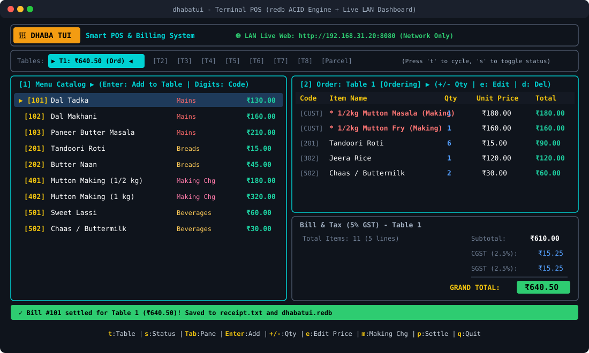

# 🍲 DhabaTUI

[](https://github.com/itsvrushabh/dhabatui/actions/workflows/ci.yml)
[](https://www.rust-lang.org/)
[](https://github.com/ratatui-org/ratatui)
[](https://github.com/cberner/redb)
[](LICENSE)

A lightning-fast, keyboard-driven Terminal User Interface (TUI) Point-of-Sale (POS) and billing application built specifically for Indian dhabas, roadside eateries, and small-scale restaurants.

---

## 🖥️ Live Terminal Interface



```text
┌─ 🍲 DHABA TUI   Smart POS & Billing System ────────────────────────────────────────────────────────┐
└────────────────────────────────────────────────────────────────────────────────────────────────────┘
┌─ Dining Tables & Takeaway (Press 't' to cycle, 's' to toggle status) ──────────────────────────────┐
│ Tables: ▶[T1: ₹640.50 (Ordering)]◀  [T2]  [T3]  [T4]  [T5]  [T6]  [T7]  [T8]  [Parcel]         │
└────────────────────────────────────────────────────────────────────────────────────────────────────┘
┌─ [1] Menu Catalog ▶ (Enter: Add | Digits: Quick Code) ──┬─ [2] Order: Table 1 [Ordering] ▶ ────────┐
│ Code  Item Name             Category       Price        │ Code  Item Name                 Qty Total│
│ ▶ 101 Dal Tadka             Mains        ₹130.00        │ [CUST]* 1/2kg Mutton Masala (M)   1 ₹180 │
│   102 Dal Makhani           Mains        ₹160.00        │ [CUST]* 1/2kg Mutton Fry (Making) 1 ₹160 │
│   103 Paneer Butter Masala  Mains        ₹210.00        │ [201] Tandoori Roti               6  ₹90 │
│   201 Tandoori Roti         Breads        ₹15.00        │ [302] Jeera Rice                  1 ₹120 │
│   202 Butter Naan           Breads        ₹45.00        │ [502] Chaas / Buttermilk          2  ₹60 │
│   401 Mutton Making (1/2kg) Making Chg   ₹180.00        ├──────────────────────────────────────────┤
│   402 Mutton Making (1 kg)  Making Chg   ₹320.00        │ Total Items: 11 (5 lines)  Subtotal: ₹610│
│   501 Sweet Lassi           Beverages     ₹60.00        │                            CGST:   ₹15.25│
│   502 Chaas / Buttermilk    Beverages     ₹30.00        │                            SGST:   ₹15.25│
│                                                         │                            TOTAL: ₹640.50│
├─────────────────────────────────────────────────────────┴──────────────────────────────────────────┤
│ ✓ Bill #101 settled for Table 1 (₹640.50)! Saved to receipt.txt                                   │
├────────────────────────────────────────────────────────────────────────────────────────────────────┤
│ t:Table | s:Status | Tab:Pane | Enter:Add | +/-:Qty | e:Edit Price | m:Making Chg | p:Settle | q:Quit│
└────────────────────────────────────────────────────────────────────────────────────────────────────┘
```

---

## 📦 Installation & Download

### Option 1: Pre-Built Release Binaries (Recommended — No Rust Required)
Download the ready-to-run binary package for your operating system from **[GitHub Releases](https://github.com/itsvrushabh/dhabatui/releases)**:

| Platform | Download Package | Format | How to Run |
| :--- | :--- | :--- | :--- |
| 🐧 **Linux (x86_64)** | `dhabatui-v*-x86_64-unknown-linux-gnu.tar.gz` | `.tar.gz` archive | Extract and run `./dti` or `./dhabatui` |
| 🪟 **Windows (x86_64)** | `dhabatui-v*-x86_64-pc-windows-msvc.zip` | `.zip` archive | Extract and double-click / run `dti.exe` |
| 🍏 **macOS Apple Silicon (M1/M2/M3/M4)** | `dhabatui-v*-aarch64-apple-darwin.tar.gz` | `.tar.gz` archive | Extract and run `./dti` or `./dhabatui` |
| 🍏 **macOS Intel (x86_64)** | `dhabatui-v*-x86_64-apple-darwin.tar.gz` | `.tar.gz` archive | Extract and run `./dti` or `./dhabatui` |

*Every package contains both the full `dhabatui` binary and the fast `dti` alias.*

### Option 2: Install via Cargo
If you have the Rust toolchain installed, install directly from [crates.io](https://crates.io/crates/dhabatui):
```bash
cargo install dhabatui
# or install latest from git
cargo install --git https://github.com/itsvrushabh/dhabatui.git
```
*(Automatically places both `dti` and `dhabatui` executables into your `~/.cargo/bin/`).*

---

## ⚡ Quick Start

Once downloaded or installed, launch DhabaTUI directly from any terminal:

```bash
dti
# or
dhabatui
```

---

## 🌟 Key Features

- **⚡ Zero-Mouse Keyboard Speed**: Designed so cashiers never need to reach for a mouse during peak rush hours.
- **🪑 Multi-Table Management**: Live tracking across **8 Dining Tables** (`T1`–`T8`) plus **Parcel Takeaway** with independent carts and statuses (`Vacant`, `Ordering`, `Served`, `Billed`).
- **🥩 Customer Meat Cooking Charges (*Banwai*)**: Highway dhabas frequently cook raw meat brought by customers. Press <kbd>m</kbd> to add custom cooking descriptions and prices on the fly.
- **✏️ On-The-Fly Price Alteration**: Press <kbd>e</kbd> to negotiate or adjust dish prices for bulk orders without touching the permanent menu catalog.
- **🔢 Numeric Quick-Code Entry**: Cashiers who memorize dish codes (e.g. `101`) can type numbers directly to add dishes in milliseconds.
- **💾 Embedded ACID Database (`redb`)**: Single-file embedded storage (`dhabatui.redb`) guarantees zero database corruption even during abrupt power cuts.
- **🧾 ESC/POS 80mm Receipt Printing**: Instant settlement commits to disk and formats itemized bills to [`receipt.txt`](receipt.txt).

---

## ⌨️ Common Shortcuts Cheat Sheet

| Shortcut | Description |
| :--- | :--- |
| **`t`** / **`T`** / **`Shift+Tab`** | Cycle active dining table |
| **`s`** / **`S`** | Cycle table status (`Vacant` ➔ `Ordering` ➔ `Served` ➔ `Billed`) |
| **`Tab`** / **`h`** / **`l`** | Switch focus between Menu Catalog and Order Cart |
| **`0`–`9`** + **`Enter`** | Rapid numeric dish code entry (e.g. `101` + `Enter`) |
| **`Enter`** | Add highlighted catalog dish to active table |
| **`+`** / **`-`** | Increment or decrement item quantity |
| **`m`** | **Making Charges (*Banwai*)**: Add custom meat preparation |
| **`e`** | **Alter Price**: Override unit price for active dish |
| **`p`** | **Settle Bill**: Choose payment mode (`[1] Cash`, `[2] UPI`, `[3] Khaata`), commit to `redb`, print receipt |
| **`q`** / **`Esc`** | Exit DhabaTUI or close popup modal |

---

## 📚 Complete Documentation

All detailed operating guides, architecture designs, and reference documentation are available in the [`docs/`](docs/) directory:

- 📖 **[Cashier's Guide & Workflow](docs/CASHIER_GUIDE.md)**: Full visual cashier guide with 4-step workflow, table management, making charges (*banwai*), and receipt samples.
- 🌐 **[Live Web Dashboard (LAN Only)](docs/WEB_DASHBOARD.md)**: Embedded read-only kitchen and waitstaff monitor over private Wi-Fi networks.
- 🏗️ **[System Architecture](docs/ARCHITECTURE.md)**: Embedded `redb` storage engine, multi-table domain, and thread architecture.
- 💰 **[Financials & GST Math](docs/FINANCIALS.md)**: Integer paise representation and exact half-up rounding for 2.5% CGST + 2.5% SGST.
- 🛠️ **[Developer & Testing Guide](docs/DEVELOPMENT.md)**: Building, test suite, and CI/CD pipelines.

---

## 📄 License

This project is licensed under the MIT License.
