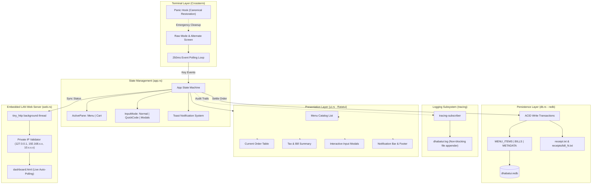

# DhabaTUI — Technical Architecture

This document outlines the internal architecture, storage engine design, and component lifecycles for `dhabatui`.

---

## 1. System Overview

DhabaTUI is built around a decoupled, state-driven model that separates the event loop, state machine, rendering pipeline, persistence layer, and logging subsystem.



---

## 2. Storage Engine: Embedded `redb`

DhabaTUI uses **[redb](https://github.com/cberner/redb)** (version 2.x), an embedded key-value store implemented in 100% safe Rust.

### Why `redb` Over SQLite for DhabaTUI?
1. **Pure Safe Rust**: Zero C dependencies, no C compiler required, and zero cross-compilation headaches.
2. **Crash Resilience**: Built on copy-on-write B-trees with MVCC (1 writer, concurrent readers). Power cuts or sudden disconnections leave the database uncorrupted.
3. **Compile-Time Type Safety**: Tables are defined as typed Rust contracts rather than dynamic SQL strings.

### Table Definitions
```rust
pub const MENU_TABLE: TableDefinition<&str, &[u8]> = TableDefinition::new("menu_items");
pub const BILLS_TABLE: TableDefinition<u64, &[u8]> = TableDefinition::new("bills");
pub const META_TABLE: TableDefinition<&str, u64> = TableDefinition::new("metadata");
```

| Table | Key Type | Value Type | Description |
| :--- | :--- | :--- | :--- |
| `menu_items` | `&str` (Dish Code, e.g. `"101"`) | `&[u8]` (JSON-serialized `MenuItem`) | Master catalog of dishes and default prices |
| `bills` | `u64` (Sequential Bill ID) | `&[u8]` (JSON-serialized `BillRecord`) | Historical bill records with line items and timestamps |
| `metadata` | `&str` (`"next_bill_id"`) | `u64` (Atomic incrementing sequence) | Counter for sequential invoice numbers |

### Transactional Checkout Lifecycle
When the cashier presses `p` to settle an order:
1. A write transaction (`db.begin_write()`) opens `metadata` and `bills`.
2. Reads `"next_bill_id"` (initialized to `101`).
3. Commits the current `bill_id` and increments `"next_bill_id"`.
4. Serializes the `BillRecord` and writes to the `bills` table.
5. Commits the transaction atomically (`write_txn.commit()`).
6. Dispatches itemized text receipt generation to `receipt.txt` and `receipts/bill_<id>.txt`.

---

## 3. Isolated File-Based Logging

Writing logs to `stdout` or `stderr` corrupts the screen when Ratatui alternate screen and Crossterm raw mode are active. 

DhabaTUI isolates all runtime logging using `tracing` and `tracing-appender`:
- **Log Target**: `dhabatui.log`
- **Appender**: Non-blocking rolling file appender on a dedicated thread.
- **Worker Guard**: Initialized in `main.rs` and dropped only on clean exit to guarantee all queued logs flush to disk.

---

## 4. Embedded LAN Read-Only Web Server

DhabaTUI includes a zero-runtime embedded web server powered by `tiny_http`:
- **Port Binding**: Binds to `0.0.0.0:8080` (auto-falling back to 8081..8089 if occupied).
- **Private Network Security**: Every incoming connection is verified against `is_lan_ip(&remote_addr)`. Only loopback (`127.0.0.1`), RFC 1918 private IPv4 (`192.168.x.x`, `10.x.x.x`, `172.16-31.x.x`), and link-local addresses are served. All other traffic receives `403 Forbidden`.
- **Auto-Syncing**: The frontend polls `GET /api/status` every 2 seconds, receiving live table states, items, and recent bills.

---

## 5. Terminal Lifecycle & Custom Panic Hook

To prevent terminal corruption on unexpected program panics, a custom panic hook is installed at application startup:

```rust
let original_hook = panic::take_hook();
panic::set_hook(Box::new(move |panic_info| {
    let _ = disable_raw_mode();
    let _ = execute!(
        io::stdout(),
        LeaveAlternateScreen,
        DisableMouseCapture,
        Show
    );
    tracing::error!(panic = ?panic_info, "Fatal panic in DhabaTUI");
    original_hook(panic_info);
}));
```

On clean exit, `main()` disables raw mode, leaves the alternate screen, and restores the standard cursor.
