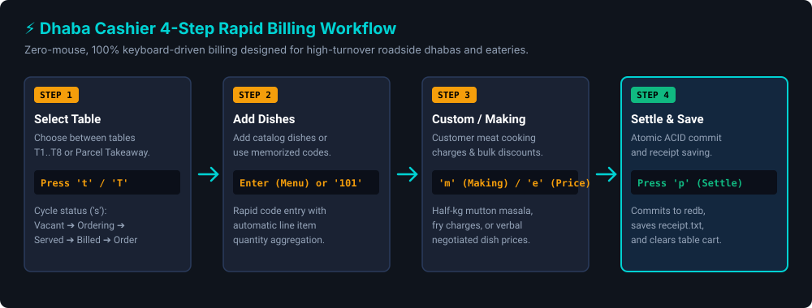
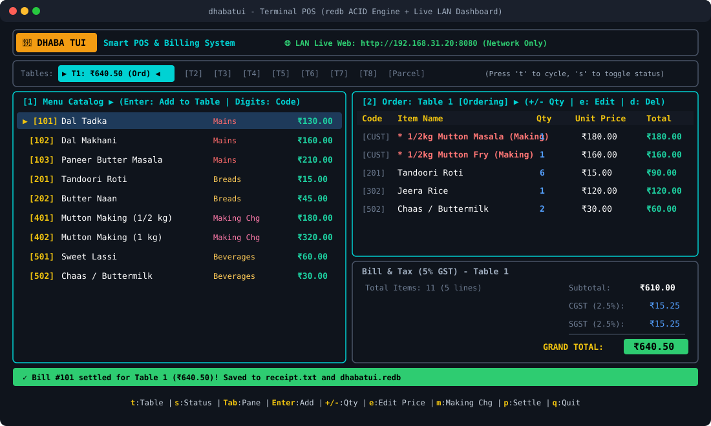

# 📖 DhabaTUI Cashier's Guide

DhabaTUI is engineered so the cashier never needs to touch a mouse. Every operation—from switching tables, rapid code ordering, customer raw meat cooking charges (*banwai*), to one-key bill settlement—is 100% keyboard-driven.

---

## ⚡ 4-Step Rapid Billing Workflow



---

## 🖥️ Terminal POS Interface



```text
┌─ 🍲 DHABA TUI   Smart POS & Billing System ────────────────────────────────────────────────────────┐
└────────────────────────────────────────────────────────────────────────────────────────────────────┘
┌─ Dining Tables & Takeaway (Press 't' to cycle, 's' to toggle status) ──────────────────────────────┐
│ Tables: ▶[T1: ₹640.50 (Ordering)]◀  [T2]  [T3]  [T4]  [T5]  [T6]  [T7]  [T8]  [Parcel]         │
└────────────────────────────────────────────────────────────────────────────────────────────────────┘
┌─ [1] Menu Catalog ▶ (Enter: Add | Digits: Quick Code) ──┬─ [2] Order: Table 1 [Ordering] ▶ ────────┐
│ Code  Item Name             Category       Price        │ Code  Item Name                 Qty Total│
│ ▶ 101 Dal Tadka             Mains        ₹130.00        │ [CUST]* 1/2kg Mutton Masala (M)   1 ₹180 │
│   102 Dal Makhani           Mains        ₹160.00        │ [CUST]* 1/2kg Mutton Fry (Making) 1 ₹160 │
│   103 Paneer Butter Masala  Mains        ₹210.00        │ [201] Tandoori Roti               6  ₹90 │
│   201 Tandoori Roti         Breads        ₹15.00        │ [302] Jeera Rice                  1 ₹120 │
│   202 Butter Naan           Breads        ₹45.00        │ [502] Chaas / Buttermilk          2  ₹60 │
│   401 Mutton Making (1/2kg) Making Chg   ₹180.00        ├──────────────────────────────────────────┤
│   402 Mutton Making (1 kg)  Making Chg   ₹320.00        │ Total Items: 11 (5 lines)  Subtotal: ₹610│
│   501 Sweet Lassi           Beverages     ₹60.00        │                            CGST:   ₹15.25│
│   502 Chaas / Buttermilk    Beverages     ₹30.00        │                            SGST:   ₹15.25│
│                                                         │                            TOTAL: ₹640.50│
├─────────────────────────────────────────────────────────┴──────────────────────────────────────────┤
│ ✓ Bill #101 settled for Table 1 (₹640.50)! Saved to receipt.txt                                   │
├────────────────────────────────────────────────────────────────────────────────────────────────────┤
│ t:Table | s:Status | Tab:Pane | Enter:Add | +/-:Qty | e:Edit Price | m:Making Chg | p:Settle | q:Quit│
└────────────────────────────────────────────────────────────────────────────────────────────────────┘
```

---

## 🚀 Step-by-Step Instructions

### 1. Launching the Counter
Open any terminal and run:
```bash
dti
# or
dhabatui
```
DhabaTUI opens in the terminal's alternate screen buffer without modifying your shell history.

---

### 2. Switching Dining Tables (`t` & `s`)
- **Cycle Active Table**: Press **`t`** to cycle forward through tables `T1` through `T8` and `Parcel Takeaway` (or **`Shift+Tab`** to cycle backward).
- **Toggle Table Operational Status**: Press **`s`** to cycle the active table's status:
  - `Vacant` ➔ `Ordering` ➔ `Served` ➔ `Billed`
- When you add the first dish to an empty table, its status automatically transitions from `Vacant` to `Ordering`.

---

### 3. Adding Standard Dishes
- **Browse & Add**: Use `j` / `k` (or `↑` / `↓`) to scroll through the Menu Catalog in the left pane. Press **`Enter`** to add the highlighted item to the active table's cart.
- **Auto-Increment**: Adding the same item multiple times automatically increments its quantity in the cart without creating duplicate lines.

---

### 4. Rapid Quick-Code Entry (Rush Hours)
Dhaba cashiers frequently memorize dish numbers for speed:
- Simply type the dish code numbers directly on your keyboard (e.g. `1`, `0`, `1`).
- A red `[Code: 101_]` indicator appears in the header.
- Press **`Enter`** to immediately add it to the active table.
- Press **`Esc`** or **`Backspace`** to cancel or delete mistyped digits.

---

### 5. Customer-Supplied Raw Meat / Making Charges (*Banwai*)
A hallmark of Indian highway dhabas: customers bring their own raw meat, chicken, or fish (e.g. *1 kg mutton*) and ask the cook to prepare it into separate dishes (*half kg masala, half kg fry*):

1. Press **`m`** anywhere to open the **Making Charge Modal**.
2. **Step 1**: Type the custom description (e.g., `1/2kg Mutton Masala (Making)`) and press `Enter`.
3. **Step 2**: Enter the negotiated cooking charge (e.g., `180.00`) and press `Enter`.
4. The dish is immediately added to the table's bill with a special `*` custom marker!

*(Tip: Standard cooking rates like code `401` for Mutton 1/2kg and `402` for Mutton 1kg can also be added via quick code).*

---

### 6. Altering Prices on the Go
To provide a verbal bulk discount or alter a price for the current order:
1. Press **`Tab`** or **`l`** (Right Arrow) to switch focus to the **Current Order** pane.
2. Use `j` / `k` to highlight the item you want to adjust.
3. Press **`e`** to open the **Alter Unit Price** modal.
4. Type the new unit price (e.g. `160.00`) and press `Enter`.
5. The line total, subtotal, and GST recalculate instantly for this order without altering the permanent menu catalog.

---

### 7. Adjusting Quantities & Line Items
With the **Current Order** pane focused:
- **`+`** or **`=`**: Increase quantity by 1.
- **`-`**: Decrease quantity by 1 (removes line if it reaches 0).
- **`d`**: Delete the highlighted line item completely.
- **`c`**: Clear the active table's entire order.

---

### 8. Settle & Save Receipt
When the customer is ready to pay:
- Press **`p`** anywhere.
- The active table's order is atomically committed to `redb` under a sequential invoice number (e.g. `#101`) tagged with the table ID.
- The itemized bill is exported to `receipt.txt` (formatted for standard 80mm receipt format) and archived to `receipts/bill_<id>.txt`.
- The table resets to `Vacant` and a confirmation banner confirms settlement.

---

## ⌨️ Complete Keyboard Shortcuts Reference

| Shortcut | Context | Action |
| :--- | :--- | :--- |
| **`t`** / **`T`** | Global | Cycle active table forward (`T1`..`T8`, `Parcel`) |
| **`Shift+Tab`** | Global | Cycle active table backward |
| **`s`** / **`S`** | Global | Cycle table status: `Ordering` ➔ `Served` ➔ `Billed` (resets on settle `p` or clear `c`) |
| **`Tab`** | Global | Toggle focus between **Menu Catalog** and **Current Table Order** |
| **`h`** / **`Left`** | Global | Focus **Menu Catalog** |
| **`l`** / **`Right`** | Global | Focus **Current Table Order** |
| **`j`** / **`Down`** | Active Pane | Move selection cursor down |
| **`k`** / **`Up`** | Active Pane | Move selection cursor up |
| **`0`–`9`** | Menu Pane | Direct numeric quick code entry (e.g. `101` + `Enter`) |
| **`Enter`** | Menu Pane | Add selected dish or increment count in active table's order |
| **`+`** / **`=`** | Cart Pane | Increase quantity of selected item |
| **`-`** | Cart Pane | Decrease quantity of selected item |
| **`e`** / **`E`** | Cart Pane | **Alter price on the go**: modal prompt to override unit price |
| **`m`** / **`M`** | Global | **Add Custom / Making Charge**: modal for dish description & price |
| **`d`** / **`D`** | Cart Pane | Delete selected item line from order |
| **`c`** / **`C`** | Global | Clear active table's order |
| **`p`** / **`P`** | Global | **Settle & Save**: commit to `redb`, write `receipt.txt`, and clear table |
| **`q`** / **`Esc`** | Global | Cleanly exit DhabaTUI (or dismiss open popup modal) |

---

## 🧾 Sample Saved Receipt (`receipt.txt`)

```text
============================================================
                      DHABA TUI BILL
============================================================
Bill No: #101             Table: T1       Date: 2026-11-01 12:25:30
------------------------------------------------------------
Item                            Qty    Price        Total
------------------------------------------------------------
* 1/2kg Mutton Masala (Making)    1  ₹180.00      ₹180.00
* 1/2kg Mutton Fry (Making)       1  ₹160.00      ₹160.00
Tandoori Roti                     6   ₹15.00       ₹90.00
Jeera Rice                        1  ₹120.00      ₹120.00
Chaas / Buttermilk                2   ₹30.00       ₹60.00
------------------------------------------------------------
Total Items: 11 (5 lines)
Subtotal:                                         ₹610.00
CGST (2.5%):                                       ₹15.25
SGST (2.5%):                                       ₹15.25
------------------------------------------------------------
GRAND TOTAL:                                      ₹640.50
============================================================
                 Thank You! Visit Again!
============================================================
```
