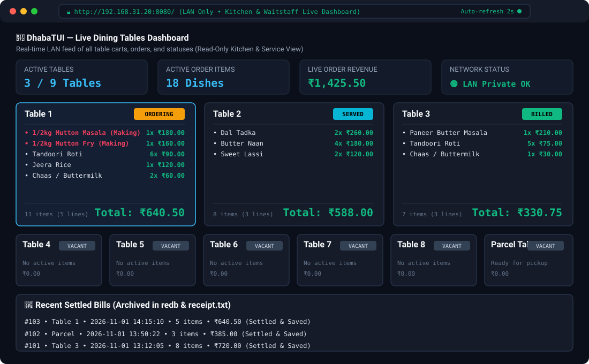

# 🌐 Live Read-Only Web Dashboard (LAN Only)

DhabaTUI includes an embedded, zero-dependency, read-only web server that starts automatically in the background when running `dhabatui` or `dti`.

This allows waitstaff, kitchen cooks, and dhaba managers to monitor dining tables, active food orders, and live revenue directly from their smartphones, tablets, or wall-mounted kitchen monitors connected to the dhaba's Wi-Fi.

---

## 📱 Live Web Dashboard Interface



---

## 🔒 Security: Local Area Network (LAN) Only

The web dashboard is strictly intended for internal dhaba operations. The server validates every incoming HTTP request:

- **Allowed Connections**:
  - `127.0.0.1` and `::1` (Localhost loopback)
  - `192.168.0.0/16` (Home & Dhaba Wi-Fi routers)
  - `10.0.0.0/8` (Enterprise private subnets)
  - `172.16.0.0/12` (Private IP ranges & container bridges)
  - `169.254.0.0/16` (IPv4 link-local)
- **Blocked Connections**:
  - Any request from an external/public IP address is immediately denied with an HTTP **`403 Forbidden`** response.

---

## ⚙️ How It Works

### 1. Automatic IP & Port Detection
When DhabaTUI boots:
1. It probes the active local outbound interface using a lightweight UDP query to determine your LAN IPv4 address (e.g. `192.168.31.20`).
2. It attempts to bind to port `8080`. If `8080` is in use by another service, it automatically tries consecutive ports up to `8089`.
3. The server starts on a dedicated background thread without interfering with the terminal UI or consuming excessive CPU.

### 2. Accessing the Dashboard
Any device on the same local Wi-Fi can open the dashboard in standard web browsers (Safari, Chrome, Firefox):
```text
http://<your-machine-ip>:8080/
```
*(Example: `http://192.168.31.20:8080/`)*

---

## 📊 Dashboard Features

- **Live Dining Table Grid**:
  - Real-time status badges for tables **`T1` through `T8`** and **`Parcel Takeaway`**:
    - `VACANT` (Gray): Table is available.
    - `ORDERING` (Amber): Active order in progress.
    - `SERVED` (Cyan): Food delivered to table.
    - `BILLED` (Green): Bill presented or settled.
  - Itemized dish breakdown showing dish name, custom making charge markers (`*`), quantities, and line totals.
- **Dhaba Metrics Summary**:
  - **Active Tables**: Count of currently occupied tables.
  - **Kitchen Queue Items**: Total count of dishes being prepared or served across the dhaba.
  - **Live Order Revenue**: Real-time sum of all active orders.
- **Recent Settled Bills**:
  - Displays the last 10 settled bills with bill IDs, table IDs, timestamps, and amounts.
- **Zero-Reload Auto-Sync**:
  - The client-side dashboard polls the `/api/status` endpoint every 2 seconds, reflecting any table updates, dish additions, or price alterations made on the terminal POS instantly.

---

## 🔌 HTTP API Endpoints

| Endpoint | Method | Response | Description |
| :--- | :--- | :--- | :--- |
| **`/`** | `GET` | `text/html` | Serves the responsive dark-themed dashboard frontend. |
| **`/api/status`** | `GET` | `application/json` | Returns live JSON state of all tables, carts, revenue, and recent bills. |

### Sample JSON Response (`/api/status`):
```json
{
  "total_active_tables": 1,
  "total_live_revenue_formatted": "₹640.50",
  "lan_url": "http://192.168.31.20:8080",
  "updated_at": "14:15:30",
  "tables": [
    {
      "id": "T1",
      "label": "Table 1",
      "status": "Ordering",
      "status_color": "yellow",
      "total_items": 11,
      "total_formatted": "₹640.50",
      "items": [
        {
          "name": "1/2kg Mutton Masala (Making)",
          "quantity": 1,
          "price_formatted": "₹180.00",
          "total_formatted": "₹180.00",
          "is_custom": true
        },
        {
          "name": "Tandoori Roti",
          "quantity": 6,
          "price_formatted": "₹15.00",
          "total_formatted": "₹90.00",
          "is_custom": false
        }
      ]
    }
  ],
  "recent_bills": [
    {
      "id": 101,
      "table_id": "T1",
      "timestamp": "2026-11-01 14:15:00",
      "total_formatted": "₹640.50",
      "items_count": 11
    }
  ]
}
```
